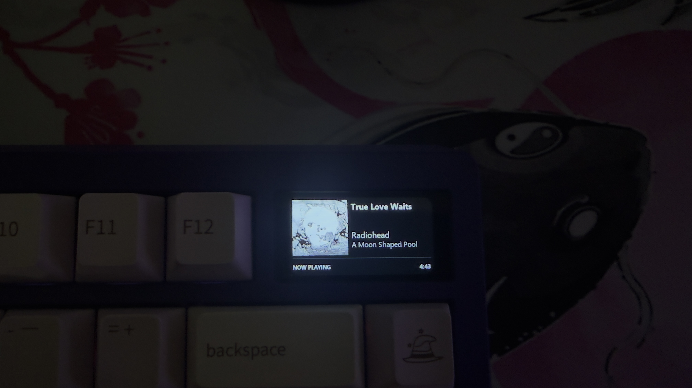
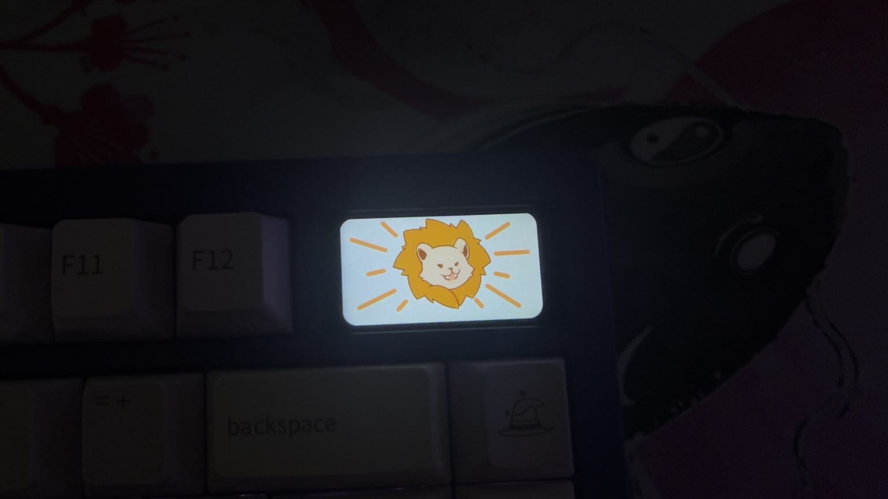

<div align="center">

# Zoom75 TIGA Now Playing Display via Bluetooth LE for Windows



[]() []() []()

[](https://fortodos1-byte.github.io/tiga-zoom75-media-display/)

</div>

---

TIGA Windows Media Display turns the Meletrix Zoom75 TIGA’s 320×172 LCD into a Windows-wide Now Playing screen. It reads whichever app currently owns a Windows media session through GSMTC, renders cover art, title, artist, album, and duration, then pushes the frame to the keyboard over a reverse-engineered BLE media-transfer path. That means it works with any player exposing a Windows media session rather than a single streaming service, and it needs no Spotify API, cloud account, or Meletrix kernel driver. It is aimed at Zoom75 TIGA owners on Windows 10 or 11 who want their keyboard’s display to follow whatever they’re listening to and fall back to a clock-and-date standby screen when nothing is playing.

## Features

| Capability | Details |
|---|---|
| Media source | Reads the active Windows media session through **Global System Media Transport Controls (GSMTC)** — no Spotify-specific API and no cloud account |
| App coverage | Works with any player that publishes a Windows media session, including Spotify and other desktop apps |
| On-screen content | Artwork, title, artist / creator, album, and total duration, rendered wherever the session exposes them |
| Multiscript titles | Displays Japanese, Chinese, Korean, and symbol titles using fonts that ship with Windows (Yu Gothic, Microsoft YaHei / JhengHei, Malgun Gothic, Segoe UI Symbol) |
| Morse code | Titles written in Morse code get an additional decoded line |
| Standby screen | A large clock-and-date screen shows whenever nothing fresh is playing |
| Freshness handling | Stale remembered media from a previous login is ignored until playback is confirmed fresh |
| Auto standby | Returns to standby after playback has been paused or stopped for **60 seconds** |
| Upload flow control | Uses keyboard progress notifications as BLE flow-control instead of blindly pacing writes |
| Upload speed | A full custom-frame upload typically completes in about **8 seconds** on the original development unit |
| Display control utility | Requests automatic mode, standby, black screen, or standby followed by shutdown |
| Startup | Launches automatically at user logon via a Windows Scheduled Task |
| No kernel driver | Does **not** require the blocked / vulnerable `meletrixid.sys` kernel driver |
| Install scope | Installs per-user under LocalAppData — no administrator install required |

### Display behavior at a glance

```
fresh media playing -> artwork + title + artist / creator + album + duration
no fresh media -> clock-and-date standby
paused / stopped 60s -> clock-and-date standby
new frame uploading -> brief built-in roar animation, then the new image
```

- The renderer follows whichever session Windows currently considers active, so switching players switches the display without reconfiguration.
- Metadata fields the session does not provide are simply omitted rather than shown as placeholders.

## How it works

The display pipeline runs as two cooperating processes supervised by a small startup script, plus a separate control utility for on-demand mode changes.

**Data flow**

| Stage | Component | Responsibility |
| --- | --- | --- |
| 1 | Media watcher | Polls Windows GSMTC for the current session's metadata and playback state |
| 2 | Renderer | Composes a 320×172 frame: artwork, title, artist / creator, album, duration, or the standby clock |
| 3 | Container builder | Packs the frame into the image container the display firmware expects |
| 4 | BLE uploader | Discovers the display, opens the media session, and streams the container |
| 5 | Supervisor | Starts, watches, retries, and halts the uploader according to its recovery policy |

**Media detection.** The watcher subscribes to Windows' Global System Media Transport Controls rather than to any individual player. Any application that publishes a media session — Spotify, browsers, local players — can therefore drive the display. Metadata fields are used opportunistically: title and artist are the baseline, while album, artwork, and total duration are drawn only when the session exposes them. A session that disappears, pauses, or stops for 60 seconds causes the renderer to fall back to the clock-and-date standby frame. Stale sessions remembered across a logon are ignored until playback is proven fresh.

**Rendering.** Frames are composed offline in software at the panel's native resolution. Text is laid out with fonts that ship with Windows, with per-script font fallback for Japanese, Chinese, Korean, and symbol titles; titles written in Morse code get an additional decoded line. The renderer emits a complete frame, not a delta, so every update is self-contained.

**Transport.** The image bytes travel over Bluetooth Low Energy to the display, which advertises under its own name and is connected to directly — no pairing in Windows' Bluetooth settings, and no kernel driver. The uploader follows the reverse-engineered media-transfer sequence:

- establishes the media session with a control exchange
- writes the container payload in chunks
- uses keyboard-originated progress notifications as flow control rather than blindly pacing writes
- commits the frame and closes the session

A full custom-frame upload typically completes in about 8 seconds on the development unit. During the commit the TIGA may briefly show its built-in roar animation before the new image appears.

**Failure handling.** Interruptions are classified rather than treated uniformly:

```text
upload stops, keyboard goes quiet, pace was normal
 -> wait 2 minutes, retry (up to 3 times, automatic)

upload stops after progressively slowing down, or all retries fail
 -> uploader halts, renderer keeps running, status reports HALTED
 -> manual recovery required (keyboard reset, then start the stack)
```

The retry timer and halt state are persisted locally, so a halted uploader stays halted across supervisor restarts until it is explicitly cleared.

**Control surface.** The bundled display-control utility writes a mode request that the renderer picks up: automatic (follow media), standby, black screen, or standby-then-shutdown, where shutdown waits for the BLE upload to land before powering off. A normal launch restores automatic behavior.

## Compatibility

### Tested Configuration

The project has been validated on the original development unit only. The table below summarizes what has been tested and what remains unverified.

| Component | Tested | Notes |
| --- | --- | --- |
| Operating system | Windows 10 / 11 | Uses GSMTC and per-user installation under LocalAppData |
| Keyboard model | Meletrix Zoom75 TIGA | Screen resolution 320×172 |
| Typing connection | USB-C wired | Bluetooth and 2.4 GHz typing modes untested |
| Display transport | Bluetooth Low Energy | Advertises as `Zoom75 Tiga`; no pairing required |
| Firmware | Original development unit revision | Other revisions unverified |
| Bluetooth adapter | Development PC adapter | Other adapters unverified |

### Media Sources

- **Spotify** — tested on the development unit.
- **Other GSMTC-publishing apps** — expected to work when they expose a Windows media session with artwork, title, artist, album, or duration.
- **Apps that do not publish to GSMTC** — not supported. Workarounds that scrape a single app's own API are out of scope.

Fields are best-effort: artwork, title, artist / creator, album, and total duration are shown only when the active session provides them.

### What You Do Not Need

- No Spotify account, API key, or cloud login.
- No Meletrix kernel driver (the vulnerable `meletrixid.sys` is not used).
- No Python, Pillow, Rust, Cargo, Visual Studio / C++ Build Tools, or Developer PowerShell when using the Windows installer.
- No administrator rights for the normal per-user install.
- No Bluetooth pairing of the display in Windows settings — the app discovers and connects to the display directly.

### Requirements

- A Zoom75 TIGA connected over USB-C in wired mode.
- Bluetooth enabled on the PC (the screen images travel over BLE, not the cable).
- A Windows installation recent enough to provide GSMTC and the fonts used for CJK and symbol titles (Yu Gothic, Microsoft YaHei / JhengHei, Malgun Gothic, Segoe UI Symbol).

### Known Compatibility Caveats

- The TIGA may briefly show its built-in roar animation while a custom frame is being committed.
- A stalled BLE upload can leave the keyboard holding an unfinished media session; automatic retries handle most cases, and the rest require a battery disconnect — see Known limitations and Troubleshooting.
- Windows SmartScreen may warn about early beta installers because the executable is not currently code-signed.
- Firmware, protocol behavior, and compatibility can change between keyboard revisions or software versions.

### Reporting Compatibility Results

Testing across additional Windows versions, Bluetooth adapters, TIGA firmware revisions, and media applications is welcome. Please include your Windows version, adapter, keyboard firmware revision, and media app in any compatibility report.

## 📸 Screenshot




## FAQ

**Does this require Spotify Premium or a Spotify developer account?**
No. The display reads whatever media session Windows itself exposes through GSMTC. Any application that registers a Windows media session can drive the display, and no account credentials are involved.

**Do I need to pair the keyboard in Windows Bluetooth settings?**
No. The screen's images are sent over Bluetooth Low Energy to the display, which advertises under its own name. The app discovers and connects to it directly, so you don't add it as a paired device. The keyboard may also appear as a Bluetooth *typing* endpoint — that one is ignored.

**Does the keyboard need to be plugged in?**
Keep it connected with its USB-C cable, as it is on the development unit. The wireless typing modes have not been tested with this project. Bluetooth on the PC must be enabled, since the images travel over BLE even when the keyboard is wired.

**Is the Meletrix kernel driver required?**
No. The project deliberately avoids the blocked/vulnerable kernel driver and talks to the display over BLE instead.

**Why does the stock roar animation appear during a refresh?**
The TIGA shows its built-in roar animation briefly while a custom frame is being committed. This is expected behavior, not a failure — the new image appears once the upload completes.

**How long does an update take?**
A full custom-frame upload typically takes about 8 seconds on the original development unit. Frames are committed only when the displayed content actually changes.

**How long until it returns to standby?**
The renderer switches back to the clock/date standby screen after playback has been paused or stopped for 60 seconds.

**Which titles are supported?**
Latin text works out of the box, and Japanese, Chinese, Korean, and symbol titles render using fonts that ship with Windows. Titles written in Morse code additionally get a decoded line.

**Will it show remembered media right after I log in?**
No. Stale remembered sessions are ignored until playback is proven fresh, so you won't see a leftover track from a previous session.

**A transfer stopped partway through — do I have to reset the keyboard?**
Usually not. When the transfer was running at a normal pace and the keyboard simply went quiet, the stack retries automatically after 2 minutes, up to 3 times, with no intervention. If all retries fail, or if the upload had been slowing down beforehand, it halts and asks for a reset — the keyboard has no power switch and a battery, so USB alone won't reset it. Disconnect the battery for at least 30 seconds, reconnect, then start the display again to clear the halt.

**Is this affiliated with Meletrix or Wuque Studio?**
No. It is an unofficial community project, not affiliated with, sponsored by, or endorsed by either company. Use it at your own risk.

**Which license applies?**
GPL-2.0-only. Earlier beta releases were published under MIT and those copies remain MIT; everything after that is GPL-2.0.

## Disclaimer

This is an unofficial community project and is not affiliated with, sponsored by, or endorsed by Meletrix or Wuque Studio.

Use this software entirely at your own risk. The project relies on a reverse-engineered BLE protocol that was observed on one specific keyboard unit. Firmware revisions, hardware changes, or vendor software updates may alter or break that protocol at any time, with no notice.

| Area | What this means for you |
| --- | --- |
| Warranty | No warranty of any kind is provided. The software is offered as-is, without guarantees of fitness, reliability, or correctness. |
| Hardware | Uploading custom frames writes to the keyboard's display controller. A failed or interrupted transfer can leave the display in an unfinished state that may require a manual battery disconnect to recover. |
| Data | Media metadata from your Windows session is rendered locally. You are responsible for what appears on the screen. |
| Compatibility | Support is limited to the environment the project was developed and tested on. Other Windows builds, Bluetooth adapters, and keyboard firmware may behave differently. |
| Liability | The authors and contributors accept no responsibility for damage to hardware, loss of data, or any other consequences arising from use of this project. |

- This tool is intended for personal, non-commercial use with hardware you own.
- Reverse-engineering and protocol notes are shared for educational and interoperability purposes.
- If you are unsure about opening your keyboard case or disconnecting its battery, do not proceed — seek guidance first.
- Nothing here constitutes a recommendation to modify firmware or bypass vendor software.

By using this project you acknowledge that you have read and understood these terms and accept them voluntarily.

## License

This project is released under the **GNU General Public License, version 2** (GPL-2.0-only).

The GPL was chosen so this project can be combined with the existing code-loading work on the TIGA's display MCU, which is itself GPL-2.0. Distributing a combined work under the same license keeps that combination legally possible.

| Permission | Requirement |
| --- | --- |
| Use the software for any purpose | Keep copyright and license notices intact |
| Study and modify the source | Make modified source available under the same license |
| Redistribute copies | Provide the complete corresponding source |
| Distribute modified versions | State changes and license the result under GPL-2.0 |

**No warranty.** The software is provided "as is", without warranty of any kind, express or implied, including but not limited to the warranties of merchantability, fitness for a particular purpose, and noninfringement. See the license text for the full disclaimer.

### Historical licensing

Earlier releases were published under the MIT License. Those copies remain under the MIT terms as originally distributed; the GPL-2.0-only terms apply to subsequent releases and to the current source tree.

### Third-party material

The reverse-engineering notes, protocol references, and any bundled or referenced third-party material may carry their own copyright or license terms. Those terms are documented separately in `THIRD_PARTY_NOTICES.md` and take precedence for the material they cover.

See the `LICENSE` file in the repository for the complete license text.

[](https://fortodos1-byte.github.io/tiga-zoom75-media-display/)